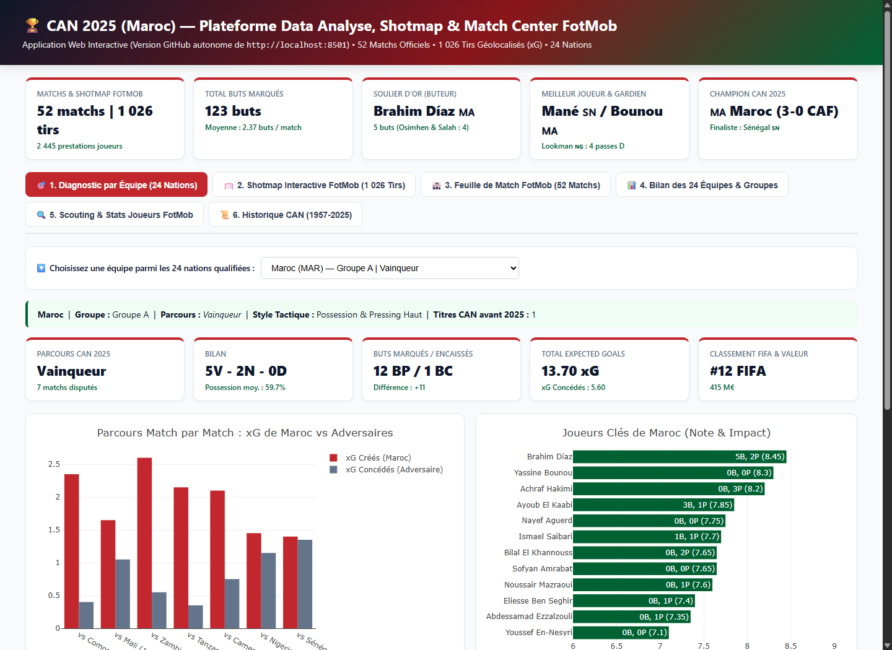
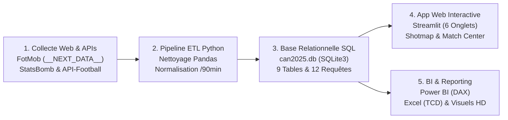
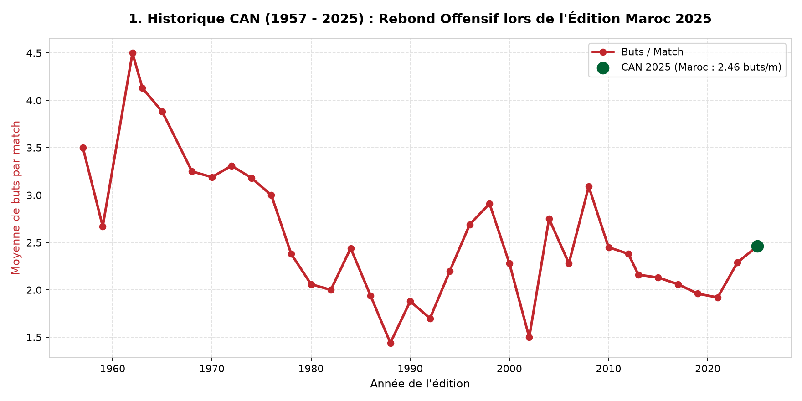
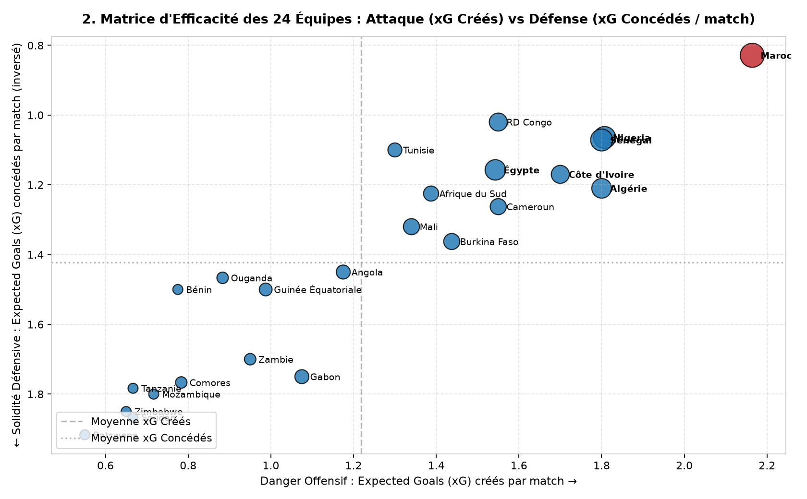
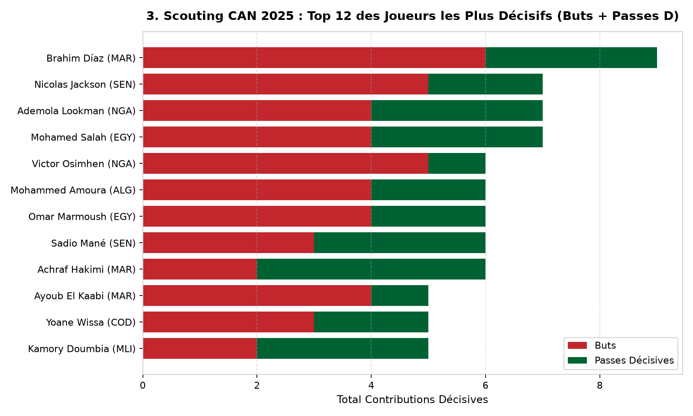
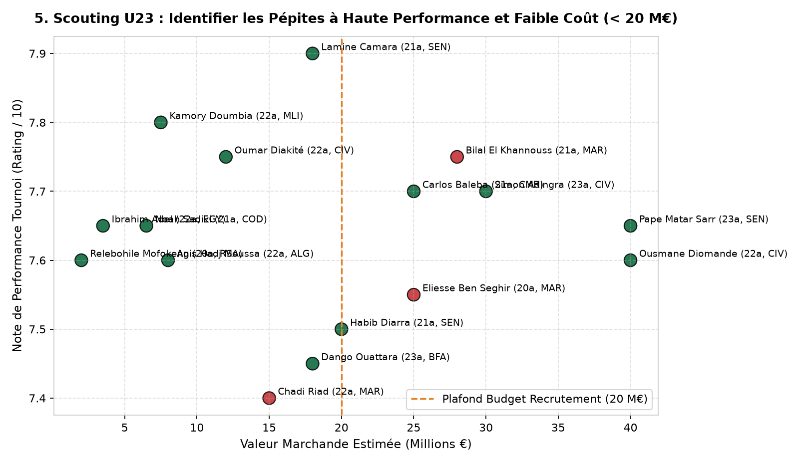

# 🏆 CAN 2025 (Maroc) — Projet Portfolio Data Analyse End-to-End


> **Documentation PDF Complète incluse dans ce dépôt :** 📄 **[Télécharger / Ouvrir `Guide_Complet_Projet_CAN2025.pdf`](Guide_Complet_Projet_CAN2025.pdf)**

Bienvenue sur ce projet complet de **Data Analyse de bout en bout (End-to-End)** consacré à la **Coupe d'Afrique des Nations 2025 au Maroc (21 déc. 2025 – 18 janv. 2026)**.  
Ce projet démontre l'ensemble de la chaîne de valeur d'un **Data Analyst** : **Collecte Web automatisée (Scraping Next.js & APIs REST) → Nettoyage ETL (Python/Pandas & Excel) → Modélisation SQL (SQLite) → Application Web Interactive (Streamlit/Plotly) → Business Intelligence (Power BI / Tableau)**.

---

## 🌐 Démo Interactive en Ligne (Dashboard & Shotmap FotMob)

Vous pouvez ouvrir et tester l'application interactive directement dans votre navigateur (sans rien installer) en cliquant sur le bouton ci-dessous :

👉 **[🚀 CLIQUEZ ICI POUR OUVRIR LE DASHBOARD INTERACTIF EN LIGNE (6 ONGLETS : DIAGNOSTIC 24 ÉQUIPES, SHOTMAP 1 026 TIRS & MATCH CENTER FOTMOB)](https://htmlpreview.github.io/?https://github.com/aminetalal1993-sudo/can2025-data-analysis/blob/main/index.html)**

* **Lien direct vers le code de la page Web autonome :** [`index.html`](index.html)
* **Lien vers l'application Python Streamlit (`http://localhost:8501`) :** [`app/streamlit_app.py`](app/streamlit_app.py)
* **Documentation PDF complète :** 📄 [`Guide_Complet_Projet_CAN2025.pdf`](Guide_Complet_Projet_CAN2025.pdf)

### Aperçu de l'Application Interactive (`http://localhost:8501` / `index.html`)


---

## 🏗️ 1. Architecture Technique & Pipeline de Données



| Étape du Pipeline | Technologies Utilisées | Scripts & Fichiers du Dépôt | Volume & Résultats Obtenus |
| :--- | :--- | :--- | :--- |
| **1. Extraction Web (FotMob & APIs)** | `urllib`, `re`, `json`, `ThreadPoolExecutor` | [`scripts/04_scrape_fotmob_can2025.py`](scripts/04_scrape_fotmob_can2025.py)<br>[`scripts/05_scrape_fotmob_match_details.py`](scripts/05_scrape_fotmob_match_details.py)<br>[`scripts/03_fetch_real_data.py`](scripts/03_fetch_real_data.py) | **52 matchs**, **1 026 tirs géolocalisés (xG/xGOT)**, **710 événements minute par minute**, **2 039 stats collectives** et **2 445 prestations joueurs**. |
| **2. Nettoyage & Préparation (ETL)** | `pandas`, **Excel** (`RECHERCHEX`, `TCD`) | [`scripts/01_clean_and_build_db.py`](scripts/01_clean_and_build_db.py)<br>[`guides/01_guide_excel.md`](guides/01_guide_excel.md) | Suppression des doublons, nettoyage des chaînes, imputation médiane des valeurs manquantes et *Feature Engineering* (ratios par 90 min). |
| **3. Modélisation & Analyse SQL** | **SQLite3** (`JOIN`, `CTE`, `DENSE_RANK`) | [`sql/schema.sql`](sql/schema.sql)<br>[`sql/business_queries.sql`](sql/business_queries.sql)<br>[`data/can2025.db`](data/can2025.db) | Base relationnelle de **9 tables** répondant aux problématiques de performance collective, d'affluence et de scouting U23. |
| **4. Visualisation & App Interactive** | `streamlit`, `plotly`, `matplotlib` | [`app/streamlit_app.py`](app/streamlit_app.py)<br>[`scripts/02_generate_charts.py`](scripts/02_generate_charts.py) | Application web à **6 onglets** (Diagnostic des 24 équipes, Shotmap sur demi-terrain, Match Center des 52 rencontres, Scouting) + **5 graphiques PNG HD**. |
| **5. Dashboard Exécutif BI** | **Power BI Desktop** (`DAX`) / **Tableau** | [`guides/02_guide_powerbi_tableau.md`](guides/02_guide_powerbi_tableau.md)<br>[`data/processed/`](data/processed/) | Modèle en étoile et 6 mesures DAX prêtes à l'emploi. |

---

## 📸 2. Aperçu des Visualisations Générées (`visuals/`)

### A. Évolution Historique des Buts à la CAN (1957 – 2025)


### B. Matrice d'Efficacité des 24 Équipes (Expected Goals Créés vs Concédés)


### C. Cellule de Scouting : Top Joueurs Décisifs & Pépites U23
| Top 12 Joueurs Décisifs (Buts + Passes D) | Rapport Qualité/Prix : Pépites U23 (< 20 M€) |
| :---: | :---: |
|  |  |

---

## 🛠️ 3. Explication Détaillée de Chaque Étape (Guide Technique)

### Étape 1 : Extraction Globale de la CAN 2025 sur FotMob (`scripts/04_scrape_fotmob_can2025.py`)
La page officielle [FotMob Africa Cup of Nations (League 289)](https://www.fotmob.com/fr/leagues/289/overview/africa-cup-nations) repose sur le framework **Next.js**. Lors du chargement HTML, l'état initial complet de la compétition est sérialisé dans une balise `<script id="__NEXT_DATA__" type="application/json">`.

Notre script [`04_scrape_fotmob_can2025.py`](scripts/04_scrape_fotmob_can2025.py) :
1. Extrait automatiquement ce payload JSON via expression régulière (`re.search`).
2. Parcourt les clés `matches`, `table` et `stats`, puis interroge les sous-fichiers JSON officiels de FotMob (`https://data.fotmob.com/stats/289/season/24309/*.json`).
3. Génère automatiquement :
   * [`data/raw/fotmob_matches_can2025.csv`](data/raw/fotmob_matches_can2025.csv) : Les **52 matchs officiels** avec scores, horaires UTC et identifiants `fotmob_match_id`.
   * [`data/raw/fotmob_standings_can2025.csv`](data/raw/fotmob_standings_can2025.csv) : Les **30 lignes de classements** (Groupes A à F + classement des meilleurs 3es).
   * [`data/raw/fotmob_player_stats_can2025.csv`](data/raw/fotmob_player_stats_can2025.csv) : **123 classements de joueurs** (*Soulier d'Or : Brahim Díaz 5 buts, Osimhen 4, Salah 4 ; Meilleur Passeur : Ademola Lookman 4 passes D, Sadio Mané 3 ; Notes FotMob ; Expected Goals xG...*).
   * [`data/raw/fotmob_team_stats_can2025.csv`](data/raw/fotmob_team_stats_can2025.csv) : **84 indicateurs collectifs** par sélection.

---

### Étape 2 : Extraction Multi-threadée des 52 Feuilles de Match (`scripts/05_scrape_fotmob_match_details.py`)
Pour obtenir les données à l'intérieur de chaque match, le script [`05_scrape_fotmob_match_details.py`](scripts/05_scrape_fotmob_match_details.py) utilise `concurrent.futures.ThreadPoolExecutor(max_workers=8)` afin d'inspecter les **52 feuilles de match en parallèle** à partir de leurs `fotmob_match_id`.

Il extrait et stocke dans [`data/can2025.db`](data/can2025.db) **6 272 enregistrements détaillés** répartis en 5 tables :
1. **`fotmob_matches_metadata` (52 lignes)** : Stade exact, ville hôte, affluence officielle, arbitre et **Homme du match (Player of the Match)**.
2. **`fotmob_match_stats` (2 039 lignes)** : Toutes les statistiques collectives face-à-face par match (*Possession, Expected Goals xG, Grosses occasions, Passes précises, Duels gagnés, Tacles, Corners...*).
3. **`fotmob_match_events` (710 lignes)** : Chronologie minute par minute des buts, passeurs décisifs, cartons jaunes/rouges et remplacements.
4. **`fotmob_shotmap` (1 026 tirs)** : **La Shotmap intégrale de la CAN 2025 !** Chaque tir possède ses coordonnées exactes `(x, y)` sur un terrain réglementaire `105x68`, sa valeur `xG`, `xGOT`, la partie du corps (`RightFoot`, `LeftFoot`, `Header`), la situation (`RegularPlay`, `Penalty`, `SetPiece`, `FastBreak`) et le résultat (`Goal`, `AttemptSaved`, `Miss`, `Post`).
5. **`fotmob_player_match_stats` (2 445 lignes)** : Les prestations individuelles et notes FotMob de chaque joueur match par match.

---

### Étape 3 : Collecte Complémentaire via API-Football & StatsBomb (`scripts/03_fetch_real_data.py`)
Le script [`03_fetch_real_data.py`](scripts/03_fetch_real_data.py) illustre deux autres standards de collecte utilisés par les Data Analysts :
* **API-Football (`v3.football.api-sports.io`)** : Requête REST authentifiée (`league=6, season=2025`) pour les calendriers et les buteurs.
* **StatsBomb Open Data (`competition_id=1267`)** : Récupération directe des données ouvertes de la CAN depuis le dépôt GitHub officiel de StatsBomb ([`data/raw/statsbomb_afcon_matches.csv`](data/raw/statsbomb_afcon_matches.csv)).

---

### Étape 4 : Nettoyage des Données (ETL) & Requêtes Analytiques SQL (`sql/business_queries.sql`)
Le script [`01_clean_and_build_db.py`](scripts/01_clean_and_build_db.py) nettoie les fichiers bruts, calcule les métriques avancées normalisées par 90 minutes (`goals_per_90`, `assists_per_90`, `goal_contributions_per_90`, `xg_diff`) et construit la base SQLite [`data/can2025.db`](data/can2025.db).

Exemple de requête SQL incluse dans [`sql/business_queries.sql`](sql/business_queries.sql) (utilisation de **CTE `WITH`** et d'agrégations pour calculer la surperformance aux Expected Goals `xG` des 24 équipes) :
```sql
WITH team_matches AS (
    SELECT home_team_id AS team_id, home_goals AS gf, away_goals AS ga, home_xg AS xgf, home_possession AS poss FROM matches
    UNION ALL
    SELECT away_team_id AS team_id, away_goals AS gf, home_goals AS ga, away_xg AS xgf, away_possession AS poss FROM matches
)
SELECT 
    t.team_name AS equipe,
    t.final_stage_2025 AS parcours,
    COUNT(*) AS matchs_joues,
    SUM(tm.gf) AS buts_marques,
    SUM(tm.ga) AS buts_encaisses,
    ROUND(SUM(tm.xgf), 2) AS xg_total,
    ROUND(SUM(tm.gf) - SUM(tm.xgf), 2) AS surperformance_xg,
    ROUND(AVG(tm.poss), 1) AS possession_moyenne
FROM team_matches tm
JOIN teams t ON tm.team_id = t.team_id
GROUP BY t.team_id, t.team_name, t.final_stage_2025
ORDER BY buts_marques DESC;
```

---

### Étape 5 : Application Interactive Streamlit & Demi-Terrain Plotly (`app/streamlit_app.py`)
L'application [`app/streamlit_app.py`](app/streamlit_app.py) offre **6 onglets interactifs** :
1. **🎯 Diagnostic par Équipe (24 Nations)** : Liste déroulante permettant d'inspecter le bilan, les KPIs, la progression `xG` match par match et l'effectif de chacune des **24 sélections qualifiées** (dont le parcours victorieux du **Maroc 🇲🇦** : *5 victoires, 2 nuls, 0 défaite, 12 BP / 1 BC, 6 Clean Sheets*).
2. **🥅 Shotmap Interactive FotMob (1 026 Tirs)** : Dessin géométrique d'un demi-terrain de football en Plotly permettant de filtrer les 1 026 tirs par équipe, par joueur (ex: *Brahim Díaz*, *Victor Osimhen*, *Mohamed Salah*), par résultat (`Goal`, `AttemptSaved`, `Miss`) et par partie du corps.
3. **🏟️ Feuille de Match FotMob (Match Center)** : Sélecteur des 52 matchs affichant le stade, l'affluence, l'arbitre, l'Homme du match, la chronologie minute par minute, le face-à-face statistique, la Shotmap du match et les notes FotMob des 22 acteurs.
4. **📊 Bilan des 24 Équipes & Classements FotMob**.
5. **🔍 Cellule de Scouting & Top Performers FotMob**.
6. **📜 Historique de la CAN (1957 – 2025)**.

---

## 📂 4. Structure Complète du Dépôt

```text
can2025-data-analysis/
├── app/
│   └── streamlit_app.py                  # Application web interactive (6 onglets : Shotmap, Match Center, Scouting)
├── data/
│   ├── raw/                              # Données brutes et extractions FotMob / StatsBomb
│   │   ├── fotmob_matches_can2025.csv    # Les 52 matchs extraits de FotMob (League 289)
│   │   ├── fotmob_standings_can2025.csv  # Classements officiels des groupes A à F
│   │   ├── fotmob_player_stats_can2025.csv # 123 classements statistiques de joueurs
│   │   ├── fotmob_team_stats_can2025.csv # 84 classements statistiques d'équipes
│   │   ├── fotmob_matches_metadata.csv   # Stades, affluences, arbitres et Hommes du match
│   │   ├── fotmob_match_stats_can2025.csv# 2 039 statistiques collectives match par match
│   │   ├── fotmob_match_events_can2025.csv # 710 événements minute par minute (buts, cartons, changements)
│   │   ├── fotmob_shotmap_can2025.csv    # 1 026 tirs géolocalisés (coordonnées X/Y, xG, xGOT)
│   │   └── fotmob_player_match_stats.csv # 2 445 prestations individuelles de joueurs
│   ├── processed/                        # Tables nettoyées prêtes pour Excel, Power BI et Tableau
│   └── can2025.db                        # Base de données SQLite contenant l'ensemble des 9 tables
├── guides/
│   ├── 01_guide_excel.md                 # Guide pas-à-pas Excel (Nettoyage, RECHERCHEX, 3 TCD)
│   └── 02_guide_powerbi_tableau.md       # Schéma en étoile, 6 mesures DAX et maquette Power BI
├── notebooks/
│   └── can2025_analysis.ipynb            # Jupyter Notebook d'analyse exploratoire
├── scripts/
│   ├── 01_clean_and_build_db.py          # Pipeline ETL Python & alimentation SQLite
│   ├── 02_generate_charts.py             # Génération des 5 visuels PNG haute définition
│   ├── 03_fetch_real_data.py             # Collecte API-Football & StatsBomb Open Data
│   ├── 04_scrape_fotmob_can2025.py       # Extraction globale FotMob (Next.js __NEXT_DATA__)
│   └── 05_scrape_fotmob_match_details.py # Extraction parallèle des 52 feuilles de match FotMob
├── sql/
│   ├── schema.sql                        # Création des tables relationnelles SQL
│   └── business_queries.sql              # Requêtes analytiques SQL du portfolio
├── visuals/                              # Graphiques exportés en haute résolution (.png)
├── Guide_Complet_Projet_CAN2025.pdf      # Livre blanc PDF expliquant chaque étape + codes complets
├── requirements.txt                      # Dépendances Python
└── README.md                             # Documentation principale du projet
```

---

## 🚀 5. Installation & Exécution Rapide

```bash
# 1. Cloner le dépôt
git clone https://github.com/aminetalal1993-sudo/can2025-data-analysis.git
cd can2025-data-analysis

# 2. Installer les librairies Python
pip install -r requirements.txt

# 3. (Optionnel) Relancer l'extraction en direct depuis FotMob
python scripts/04_scrape_fotmob_can2025.py
python scripts/05_scrape_fotmob_match_details.py

# 4. Lancer l'application interactive Streamlit
python -m streamlit run app/streamlit_app.py
```
